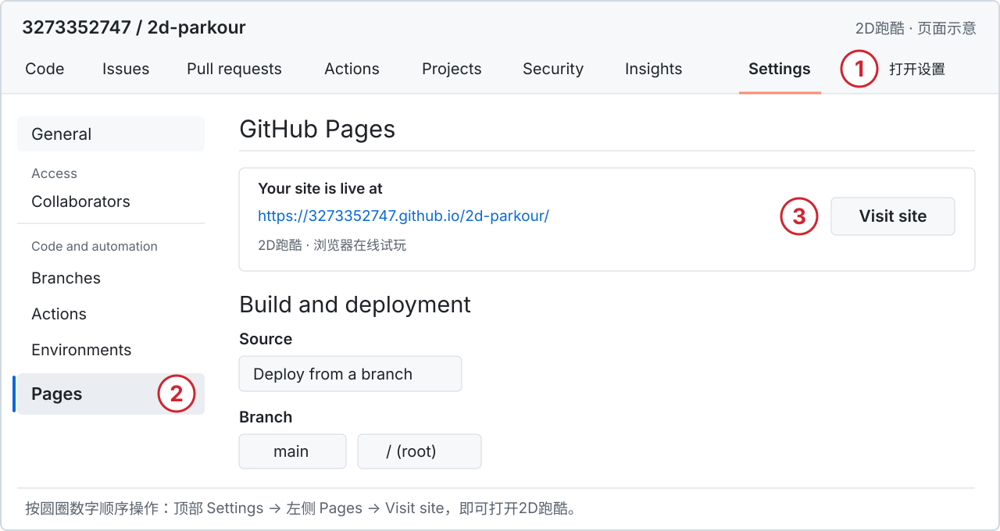

## 在线体验步骤

**直接进入：[2D跑酷在线试玩](https://3273352747.github.io/2d-parkour/)**

拥有仓库设置权限时，也可以按图中的 **① Settings → ② Pages → ③ Visit site** 打开游戏。



# 2D跑酷

使用 **Unity 2D + C#** 制作的单机跑酷游戏。场景持续滚动，玩家把握跳跃时机收集金币、避开障碍，在逐步加快的节奏中挑战更高分数。

**[在线试玩](https://3273352747.github.io/2d-parkour/)** · **[开发记录](docs/DEVELOPMENT.md)**

## 项目概览

| 项目 | 说明 |
| --- | --- |
| 游戏类型 | 单人 2D 跑酷与分数挑战 |
| 开发工具 | Unity 2022.3.62f3c1、C#、UGUI、Animator、Physics2D |
| 主要玩法 | 跳跃、金币收集、障碍躲避、暂停与结算 |
| 核心实现 | 四态游戏管理、随机地形、渐进速度和组合计分 |
| 数据保存 | PlayerPrefs保存玩家名、最高分和本局结算数据 |
| 运行平台 | WebGL、Windows |

## 游戏画面


## 玩法与操作

1. 输入玩家名并开始游戏，未填写名称时使用默认名称。
2. 地形和障碍向左滚动，通过跳跃寻找落点、收集金币并避开危险。
3. 随着游玩时间增加，场景滚动逐渐加快。保持存活、收集更多金币可以提高分数。
4. 碰到危险物或掉落检测区域后进入结算，可以重开或返回入口。
5. 结算保存本机最高分，方便继续挑战。

| 操作 | 输入 |
| --- | --- |
| 跳跃 | 空格、上方向键或游戏内跳跃按钮 |
| 暂停 / 继续 | Esc 或游戏内暂停菜单 |
| 开始、重开、返回 | 对应界面按钮 |

玩家主要控制跳跃时机，前进由场景滚动实现。

## 实现亮点

### 用状态管理暂停、计分与输入

GameManager用Ready、Playing、Paused、GameOver管理一局游戏。地形滚动、时间累计和计分读取同一套状态；暂停时切换状态并停止缩放时间，重开或返回入口时恢复，避免新场景仍停在暂停状态。

### 键盘与UI共用跳跃入口

空格、上方向键和UI按钮都调用Jump，在同一处检查游戏状态、接地和生命，再执行起跳。进入游戏后保留约0.18秒的输入解锁时间，用来隔开开始按钮的点击和第一跳。

### 随机地形保留必要约束

生成前先筛选有效的地面预制体，选择时通过有限次数重抽减少相邻重复，再限制相邻地块的高度差。地块移出屏幕后生成下一段并销毁旧实例，保持场景持续滚动。

### 难度增长与计分同步

滚动速度随有效游玩时间增加，最高限制为2.25倍。距离分按当前倍率累计，金币提供额外分数；暂停后停止累计，结束时统一计算总分。

| 参数 | 默认值 / 逻辑 |
| --- | --- |
| 基础计分速率 | 每秒6分，再乘当前速度倍率 |
| 单枚金币 | 10分 |
| 速度倍率 | min(2.25, 1 + 有效游玩秒数 × 0.035) |
| 当局总分 | 向下取整后的累计距离分 + 金币数 × 10 |

### 场景职责与本地记录分开处理

LoginScene处理玩家名和开始请求，SampleScene负责游玩，GameOverScene展示结果。PlayerPrefs保存玩家名、最高分和当局成绩，结算场景读取后展示；重新开始时重置生命和当局状态。

## 开发流程

| 阶段 | 主要工作 |
| --- | --- |
| 运动原型 | 实现刚体跳跃、地面接触、基础动画和危险碰撞 |
| 滚屏场景 | 实现地块移动、出屏判断、补位与背景运动 |
| 随机生成 | 筛选有效地块、减少相邻重复、限制高度变化 |
| 玩法反馈 | 加入金币、障碍、音效、分数和速度增长 |
| 场景整合 | 接通入口、暂停、结算、重开与最高分保存 |
| 打包验证 | 检查Windows和WebGL版本中的文字、画面和操作 |

具体模块和调试过程见 [开发记录](docs/DEVELOPMENT.md)。

## 仓库结构

```text
.
|-- index.html                 # 网页入口
|-- web/
|   |-- build-config.json      # 构建文件路径和运行配置
|   `-- boot.js                # 加载进度与错误提示
|-- Build/                     # Unity WebGL构建文件
|-- TemplateData/              # 网页样式与图片
|-- docs/
|   |-- DEVELOPMENT.md         # 开发记录
|   `-- images/                # 游戏截图
|-- licenses/                  # 字体许可证
|-- .gitignore
`-- .nojekyll
```

## 后续开发思路

后续会先改善连续跳跃和高速滚屏的体验，再增加不同的挑战目标。

### 可新增的功能

- **关卡与挑战模式**：在持续跑酷之外加入固定地图的关卡模式，以及限时收集、目标分数和连续躲避等挑战，给每局游戏不同的目标。
- **角色与外观解锁**：增加可解锁角色和皮肤，先保持相同的基础跳跃参数，让外观收集与玩法难度分开。
- **局内道具**：加入短时护盾、金币吸附和双倍得分，通过持续时间与出现频率控制收益，增加路线选择。
- **成绩统计**：记录最佳存活时间、累计金币和最近几局成绩，在结算界面展示与个人纪录的差距。

### 现有功能优化

- **跳跃响应与接地判断**：统一处理键盘和UI请求，加入同帧去重与落地输入缓冲；通过脚底检测或接触计数处理地块接缝，减少漏跳和重复起跳。
- **地形可达性**：结合跳跃轨迹、滚动速度、平台宽度和间隙筛选地块组合，加入安全回退方案，并保存随机种子复现问题地形。
- **难度节奏**：把速度、障碍密度和金币分布做成分阶段配置，让新手有熟悉操作的时间，高分阶段再逐步增加组合难度。
- **运行性能**：使用对象池复用地块、金币和障碍，复用滚动更新中的临时集合，重点观察长时间游玩的帧时间与内存变化。
- **界面与网页体验**：调整触屏跳跃按钮的位置和尺寸，统一分数、金币与结算的显示风格；完善开始后的焦点、声音恢复及不同屏幕比例下的布局。
