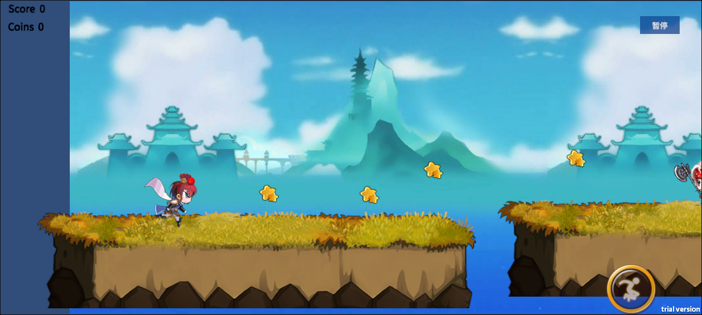

# 2D跑酷

一个使用 **Unity 2D + C#** 制作的单机跑酷 Demo。场景持续滚动，玩家把握跳跃时机收集金币、避开障碍，在逐步加快的节奏中争取更高分数。

**[在线试玩](https://3273352747.github.io/2d-parkour/)** · **[开发与发布说明](docs/DEVELOPMENT.md)** · **[测试清单](docs/TESTING.md)** · **[另一个作品：火龙探险](https://github.com/3273352747/fire-dragon-adventure)**

> 本仓库是 WebGL 试玩发布仓库，包含网页运行文件和项目文档，不包含完整 Unity 源代码。文中的 C# 类名用于说明原工程设计，不能直接把本仓库当作可编辑的 Unity 工程。

## 项目概览

| 项目 | 说明 |
| --- | --- |
| 游戏类型 | 单机 2D 跑酷与分数挑战 |
| 开发工具 | Unity 2022.3.62f3c1、C#、UGUI、Animator、Physics2D |
| 主要内容 | 玩家名输入、滚动地形、跳跃、金币、障碍、暂停与结算 |
| 核心系统 | 四态游戏管理、受约束随机地形、渐进速度、组合计分 |
| 数据保存 | PlayerPrefs保存玩家名、最高分及场景间结算数据 |
| 发布形式 | 当前仓库提供 WebGL 试玩；原工程也有 Windows 构建 |

## 游戏画面



## 玩法与操作

1. 输入玩家名并开始游戏；未填写名称时使用默认名称。
2. 地形和障碍向左滚动，玩家通过跳跃寻找落点、收集金币并避开危险。
3. 游戏时间越长，场景滚动越快；保持存活并获取金币，提高当局分数。
4. 碰到危险物或掉落检测区域后进入结算，可以重新开始或返回入口。
5. 结算比较并保存本机最高分，方便继续挑战。

| 操作 | 输入 |
| --- | --- |
| 跳跃 | 空格、上方向键或游戏内跳跃按钮 |
| 暂停 / 继续 | Esc 或游戏内暂停菜单 |
| 开始、重开、返回 | 对应界面按钮 |

这是以跳跃时机为核心的滚屏跑酷，不是通过左右方向键自由移动的横版闯关。

推荐电脑端 Chrome 或 Edge。先点击画面获得键盘焦点；首次访问需要下载资源，声音播放也可能需要用户交互。最高分属于当前浏览器的本地记录，不是服务器排行榜；清除网站数据、更换设备或使用隐私模式会影响保存结果。

## 实现亮点

### 1. 用四态管理完整游戏流程

使用 Ready、Playing、Paused、GameOver区分准备、游玩、暂停和结束。状态统一约束输入、地形滚动、计分和UI切换，减少多个布尔值互相冲突的情况。

### 2. 键盘与UI共享跳跃逻辑

空格、上方向键和UI按钮进入同一个Jump入口，并通过游戏状态与接地状态判断执行条件。场景启动后设置短输入解锁时间，降低“点击开始后误触发第一跳”的问题。

后续仍需完善同帧请求去重和多接触面接地处理，当前实现不等于完整输入缓冲系统。

### 3. 受约束的随机地形

从有效地面预制体中选取地块，通过有限重试减少相邻重复，并限制相邻高度变化。地块移出屏幕后销毁并补充下一段，维持持续滚动。

当前是“销毁与重新生成”，不是对象池；高度约束也不等于已经证明所有随机组合都可达。

### 4. 速度与收益共同增长

根据有效游玩时间提高速度，并设置最高倍率，避免无限加速。距离分随速度积累，金币提供额外分数，让持续存活和主动收集都能反映到结果中。

原工程默认参数：

| 参数 | 默认值 / 逻辑 |
| --- | --- |
| 基础计分速率 | 每秒6分，再乘当前速度倍率 |
| 单枚金币 | 10分 |
| 速度倍率 | min(2.25, 1 + 有效游玩秒数 × 0.035) |
| 当局总分 | 向下取整后的累计距离分 + 金币数 × 10 |

这些是脚本默认值，实际场景可以覆盖。暂停期间不累计正常游玩时间。

### 5. 入口、游戏和结算分离

LoginScene处理玩家名和开始请求，SampleScene负责游玩，GameOverScene展示本局结果与最高分。通过轻量持久化传递结算数据，重开时重置当局生命与流程。

### 6. 面向实际交付的发布层

保留成套WebGL构建，单独维护网页入口、加载配置、静态资源和文档。新增本地预览及路径检查工具，更新页面文案时无需重新编译游戏，更新玩法时则重新构建成套资源。

## 开发流程

| 阶段 | 主要工作 | 验证目标 |
| --- | --- | --- |
| 运动原型 | 刚体跳跃、接地、基础动画与碰撞 | 能稳定起跳和落地 |
| 滚屏循环 | 地块移动、出屏判断、补位与背景运动 | 地形能持续出现 |
| 生成约束 | 有效地块筛选、重复抑制、高度变化范围 | 避免无效地块和明显突变 |
| 玩法反馈 | 金币、障碍、音效、分数和速度增长 | 操作、反馈与结果对应 |
| 流程整合 | 入口、四态管理、暂停、结算和最高分 | 一局结束后能再次开始 |
| 网页交付 | 中文显示、画面适配、资源加载与浏览器验证 | 发布包可以独立试玩 |

详细模块说明和构建维护见 [开发与发布说明](docs/DEVELOPMENT.md)。

## 仓库结构

```text
.
|-- index.html                 # 网页入口，保持原试玩地址
|-- web/
|   |-- build-config.json      # 构建文件路径和Unity运行配置
|   `-- boot.js                # Unity加载、进度与错误反馈
|-- Build/                     # 成套WebGL构建产物
|-- TemplateData/              # 网页样式、图标与加载图片
|-- docs/
|   |-- DEVELOPMENT.md         # 模块、开发过程、构建与发布维护
|   |-- TESTING.md              # 输入、地形和状态回归清单
|   `-- images/                # 实际游戏截图
|-- licenses/
|   `-- FONT-LICENSE-NotoSansSC.txt
|-- tools/
|   |-- check-site.mjs         # 文件完整性和路径检查
|   |-- test-boot.mjs          # 启动成功与失败分支测试
|   `-- serve.mjs              # 仅本机监听的HTTP预览服务
|-- .gitignore
`-- .nojekyll
```

`Build/` 与 `TemplateData/` 保持Unity标准布局，不手改生成的游戏二进制文件。

## 本地预览

需要 Node.js 18 或更高版本，无需安装npm依赖。在仓库根目录运行：

```bash
node tools/check-site.mjs
node tools/test-boot.mjs
node tools/serve.mjs 8081
```

浏览器访问 **http://127.0.0.1:8081**，Ctrl+C停止服务。端口被占用时换一个端口即可。

不要直接通过 `file://` 打开页面。当前构建包含 `.unityweb` 文件，必须与对应loader保持配套，不能只修改扩展名来“解压”或减小包体。

## 当前边界与后续思路

以下内容作为下一步计划：

- **输入与手感**：统一采样、请求消费和物理执行，补同帧去重、落地缓冲及土狼时间，验证键盘和UI同时触发。
- **接地可靠性**：用脚底检测或有效接触计数替代单一碰撞进出布尔值，处理相邻地块接缝。
- **更完整的生成约束**：根据跳跃速度、重力、滚动速度、平台宽度和间隙校验可达性，保存随机种子以复现失败组合。
- **对象复用与分配控制**：复用出屏地块、金币和障碍，消除滚动热路径中的临时集合；用测量决定池容量。
- **可扩展难度曲线**：将速度、金币与障碍密度配置化，形成不同阶段的节奏。
- **数据和发布质量**：为计分与状态转移补自动化测试，增加存档版本与异常恢复，完善不同设备和浏览器验证。

目前没有联网排名、账号系统或跨设备同步。静态文件检查不会验证整局游戏的随机可达性；GitHub Pages访问速度也受网络影响。

## 资源与使用说明

本项目使用第三方美术、音频及字体资源，公开试玩不代表所有素材都可自由复用。本仓库不默认对全部内容授予统一开源许可。

Noto Sans SC字体使用SIL Open Font License，见 [字体许可证](licenses/FONT-LICENSE-NotoSansSC.txt)。其他素材的提取、修改及再发布应分别核对原始授权。
